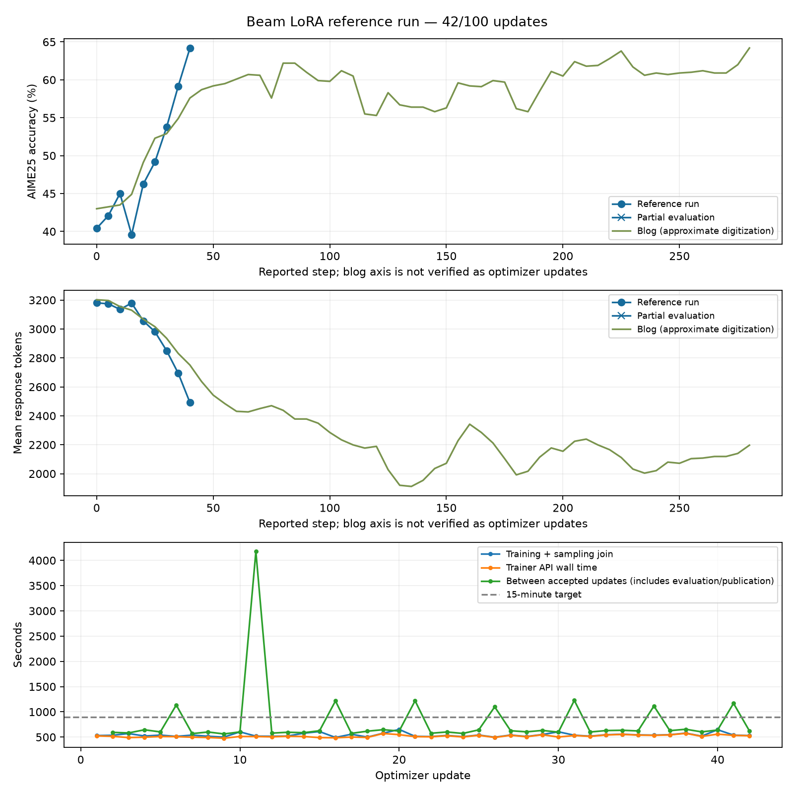

# Beam LoRA reference run results

This validation stopped after **42 accepted updates**. The latest complete AIME25
evaluation is update 40; no update-42 accuracy is reported. The originally planned
100-update learning test was not completed.

| AIME25 evaluation | Accuracy | Mean response tokens |
| --- | ---: | ---: |
| Initial | 97/240 (40.42%) | 3,180.54 |
| Update 40 | 154/240 (64.17%) | 2,492.28 |

Each evaluation uses 30 problems, eight samples per problem and a 4,096-token
response cap. Independent strict regrading agreed with all 2,160 saved responses
across nine evaluations. The update-40 accuracy change is +23.75 percentage points,
with a descriptive paired-problem 95% bootstrap interval of +12.92 to +35.83 points.
This is an intermediate comparison, not the predeclared update-100 test.

Median time between accepted updates was **621.90 seconds**, including the planned
cold restart. Median native forward/backward time was 449.40 seconds; median trainer
API wall time was 513.19 seconds. Wall time through the requested stop was 10.90 hours.

The green curves are approximate digitizations of the
[published Beam LoRA run](https://huggingface.co/blog/reflection-beam#train-with-lora).
Its reported step axis has not been verified as optimizer updates. Hardware and
orchestration differ; the comparison does not establish parity.

The cold restart at update 10 matched all 1,664 adapter/master/Adam tensors and 221
non-tensor payloads. The final checkpoint preserves optimizer step 42; the journal
records the pending policy-41 batch. Update 43 completed backward but was cancelled before optimizer
submission. Both GPU apps were stopped and had zero remaining containers.

See [run status](run-status.json), [configuration](config.json),
[deployment provenance](deployment.json), [incremental metrics](metrics.jsonl),
[summary](summary.json), [cold-restore comparison](restore-comparison-step-0010.json),
[final checkpoint audit](checkpoint-audit-step-0042.json) and
[live hardware audit](hardware-audit.json).
