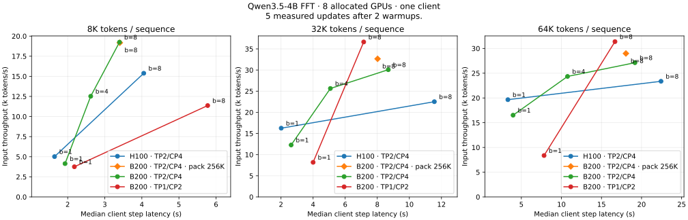
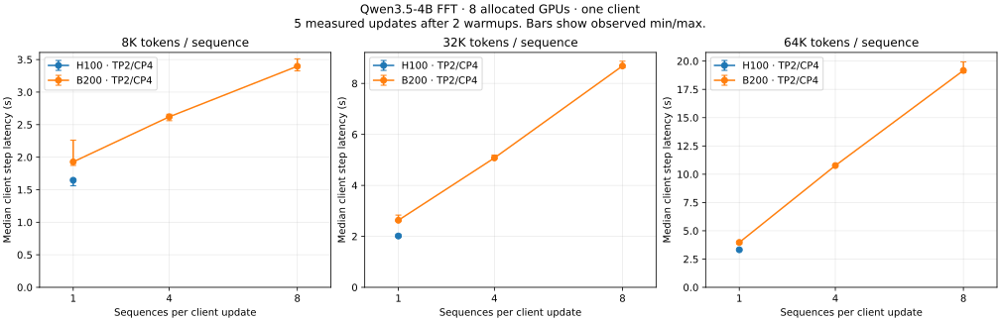

# Qwen3.5-4B FFT on Blackwell

The B200 preset uses eight GPUs, TP2/CP4, and a 262,144-token packed microbatch
limit. The **per-sequence context limit stays at 65,536 tokens**. The larger packed
microbatch uses Blackwell memory to combine multiple sequences into fewer GPU
calls; it does not extend the supported sequence length. FP32 LM-head computation,
deferred FP32 logits, and full activation recomputation are unchanged.

All GPU jobs use a single-node clustered trainer with
`platform.modal.exclude_reserved_capacity = True`. This option requires a full
GPU node. The original four-H100 recipe was not measured directly: the controlled
H100 reference also allocates eight GPUs. H100 requests use `H100!` to prevent
hardware upgrades. An initial automatic H200 upgrade and interrupted startup
attempts are excluded.

## Recorded client step latency

Each update runs cross-entropy forward/backward and Adam on synthetic repeated-text
inputs through one full-parameter client. All tokens contribute to the loss.
There are two warmups followed by five measured updates per context. These are
short exploratory runs from one allocation per configuration, not confidence
intervals or learning-quality evaluations.

| Hardware and layout | Packed-token cap | Sequences / update | 8K median (s) | 32K median (s) | 64K median (s) |
| --- | ---: | ---: | ---: | ---: | ---: |
| B200, TP2/CP4 | 64K | 1 | 1.928 | 2.632 | 3.968 |
| H100, TP2/CP4 | 64K | 1 | 1.645 | 2.013 | 3.319 |
| B200, TP2/CP4 | 64K | 4 | 2.621 | 5.077 | 10.764 |
| B200, TP2/CP4 | 64K | 8 | 3.397 | 8.687 | 19.173 |
| B200, TP1/CP2/DP4 | 64K | 8 | 5.775 | 7.154 | 16.684 |
| B200, TP1/CP2/DP4 | 64K | 1 | 2.180 | 4.001 | 7.834 |
| H100, TP2/CP4 | 64K | 8 | 4.051 | 11.557 | 22.429 |
| B200, TP2/CP4 | 256K | 8 | 3.406 | 8.020 | 18.049 |

At batch eight, the selected B200 configuration lowers median client step time
from 11.557 to 8.020 seconds at 32K and from 22.429 to 18.049 seconds at 64K against
the eight-H100 reference. Raising the packed-token cap improves the B200's own
batch-eight times from 8.687 to 8.020 seconds at 32K and from 19.173 to 18.049
seconds at 64K. The sampled memory peak exceeds 100 GiB per GPU in the larger
packed windows, which fits B200 but exceeds an H100's memory capacity.

The H100 reference has lower latency at batch one. TP1/CP2/DP4 with a 64K packed
cap is another measured option for large batches, but it regresses small batches;
the preset retains TP2/CP4 for a more balanced client workload. GPU-only estimated
cost per million tokens remains higher than H100 for the selected B200 settings.
Faster client updates are not necessarily cheaper.






## Measurement details

Context lengths are 8,192, 32,768, and 65,536 tokens. Batch size is the number of
sequences per client update. Model weights are pinned to
`851bf6e806efd8d0a36b00ddf55e13ccb7b8cd0a`. The Megatron trainer image is pinned
by the deployment recipe. Runs use the same BF16 model, FP32 LM head, deferred
FP32 logits, Adam learning rate `1e-4`, seed 42, 32 requested CPU cores, 128 GiB
requested host memory, and one compiler worker per rank.

[measurements.json](measurements.json) contains source revisions, image names,
individual measured step times, numeric client result metrics, and scheduling
settings for each complete run. The 256K packed-token measurement ran revision
`e8e3d6e` with a deployment override; revision `719a6d0` makes that measured setting
the preset default. The inherited 9B recipe retains its original settings.
A TP8/CP1 trial without recomputation regressed sharply and was stopped;
its partial records are excluded from the complete-run graphs.

Client step latency includes the forward/backward request and optimizer response.
Throughput uses completed input tokens divided by the measured client window.
Lines connect recorded points. Latency bars show the observed minimum and maximum
of five updates, not confidence intervals.

GPU memory, utilization, and power come from one-second `nvidia-smi` samples in
the measured window. Public numeric memory values are MiB, utilization is percent,
and power is watts. Sampling is incomplete for some runs; a zero sample count
means missing telemetry, not zero usage. Full client bundles retain collection
coverage information.

Cost plots estimate trainer GPU cost using the [published resource rates](https://modal.com/pricing)
on 2026-11-17: $3.9492 per H100-hour and $6.2496 per B200-hour. They count all eight
allocated GPUs, including idle data-parallel ranks. Estimates exclude startup,
idle time outside the measured window, CPU, host memory, samplers, storage, and
account discounts. They are not billed costs.

Regenerate the graphs from the repository root:

```bash
uv run python reference_runs/plot_fft.py reference_runs/results/qwen35-4b-fft-blackwell/measurements.json
```

## Run another configuration

[workload.json](workload.json) records the selected workload and deployment
settings. Change `batch_size` to compare client update sizes; change
`megatron_cfg.max_tokens_per_microbatch` in deployment overrides to compare
packing caps. Keep the per-sequence context lengths, model weights, and hardware
fixed when comparing those settings.

The benchmark controller is provided by [PR #305](https://github.com/modal-labs/spindle/pull/305).
From a checkout containing that harness, download `workload.json` and run:

```bash
uv run modal run -e YOUR_ENV -m spindle.benchmarks.controller \
  --environment YOUR_ENV --config /path/to/workload.json \
  --revision QWEN4B_PR_COMMIT --collector-app YOUR_COLLECTOR \
  --modal-secret YOUR_DEPLOYMENT_SECRET
```

Use a secret with valid deployment credentials in your benchmark environment.
The controller starts an isolated deployment and saves a portable result bundle;
that bundle can be uploaded to a Frontier training view. This command requires
the benchmark harness; it is not available on the current main branch.

## Validation limit

An additional 512-token, one-update publication probe on preset revision
`719a6d0` did not complete its first forward/backward call and was stopped. It
never reached weight publication or sampler readiness. The measured training
coverage is 8K–64K; short-context behavior and publication readiness remain
unverified. The config change remains a draft pending that validation.
