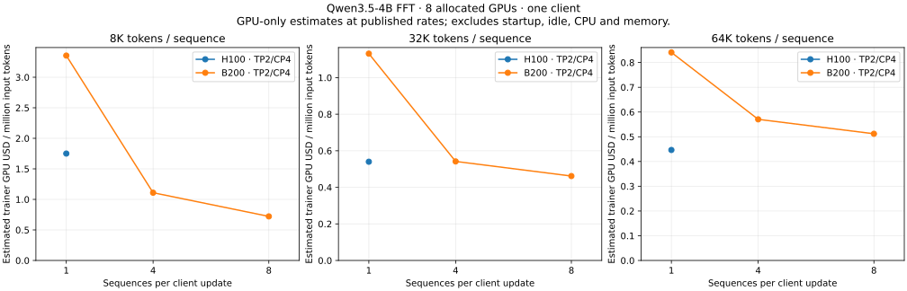

# Qwen3.5-4B FFT on Blackwell

The first comparison uses eight allocated GPUs, TP2/CP4, and one full-parameter
client. Each update runs cross-entropy forward/backward and Adam on synthetic
repeated-text inputs. All tokens contribute to the loss. Context lengths are
8,192, 32,768, and 65,536; batch size is the number of sequences per client update.
Each context has two warmups followed by five measured updates. These are short
exploratory runs, not confidence intervals or learning-quality evaluations.

All GPU jobs use a single-node clustered trainer with
`platform.modal.exclude_reserved_capacity = True`. This option requires a full
GPU node. The original four-H100 recipe was not measured directly: the H100
reference below also allocates eight GPUs. H100 requests use `H100!` to prevent
hardware upgrades. The initial automatic H200 upgrade and interrupted startup
attempts are excluded.

## Recorded client step latency

| Hardware and layout | Sequences / update | 8K median (s) | 32K median (s) | 64K median (s) |
| --- | ---: | ---: | ---: | ---: |
| H100, TP2/CP4 | 1 | 1.645 | 2.013 | 3.319 |
| B200, TP2/CP4 | 1 | 1.928 | 2.632 | 3.968 |
| B200, TP2/CP4 | 4 | 2.621 | 5.077 | 10.764 |
| B200, TP2/CP4 | 8 | 3.397 | 8.687 | 19.173 |

Changing GPU generation alone regresses small-batch client latency with this
layout. Larger batches increase throughput while increasing latency. Additional
parallelism layouts are being evaluated; the draft recipe is not yet a validated
performance improvement.




## Measurement details

Model weights are pinned to `851bf6e806efd8d0a36b00ddf55e13ccb7b8cd0a`.
The Megatron trainer image is pinned by the deployment recipe. All runs use the
same BF16 model, FP32 LM head, deferred FP32 logits, Adam learning rate `1e-4`,
seed 42, 32 requested CPU cores, 128 GiB requested host memory, and one compiler
worker per trainer rank. Revisions, image names, individual measured step times,
client result metrics, and scheduling settings are in
[measurements.json](measurements.json). Interrupted runs are not included.

Client step latency includes the forward/backward request and optimizer response.
Throughput uses completed input tokens divided by the full measured client window.
GPU memory and utilization come from one-second `nvidia-smi` samples during that
window. Sampling is incomplete for some runs; a zero sample count means missing
telemetry. It does not mean zero memory use or utilization.

Cost plots estimate trainer GPU cost using the [published resource rates](https://modal.com/pricing)
on 2026-11-17: $3.9492 per H100-hour and $6.2496 per B200-hour. They count all eight
allocated GPUs, including any idle ranks. Estimates exclude startup, idle time
outside the measurement window, CPU, host memory, samplers, storage, and account
discounts. They are not billed costs.

Regenerate the graphs from the repository root:

```bash
uv run python reference_runs/plot_fft.py reference_runs/results/qwen35-4b-fft-blackwell/measurements.json
```
